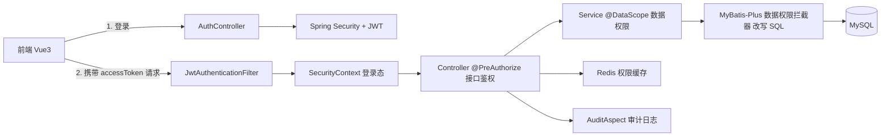

# 权限管理系统（RBAC + 数据权限 + 审计日志）

一个面向后台管理系统的权限模块：用户、角色、权限点、组织架构建模，实现菜单 / 按钮 / 接口 / 数据四层权限控制，并记录关键操作审计日志。

## 一、技术栈

| 层次 | 选型 |
| --- | --- |
| 语言 / 框架 | Java 17、Spring Boot 3.3、Spring Security 6 |
| 认证 | JWT 双令牌（access + refresh），refresh 令牌落 Redis |
| 持久层 | MyBatis-Plus 3.5（分页插件 + 数据权限插件） |
| 存储 | MySQL 8.0、Redis 7 |
| 前端 | Vue 3 + Vite + Element Plus + Vue Router |
| 构建 | Maven |

## 二、系统架构

分层职责：

| 层 | 职责 |
| --- | --- |
| `security` | JWT 生成解析、登录态还原、401/403 统一响应 |
| `service` | 业务逻辑 + 权限缓存失效 + 数据范围计算 |
| `datapermission` | 数据权限规则上下文与 SQL 改写 |
| `aspect` | `@DataScope` 设置数据范围、`@Audit` 记录审计日志 |
| `controller` | 接口定义与 `@PreAuthorize` 权限点校验 |

## 三、权限模型

四层权限自上而下收紧：

| 层次 | 实现位置 | 示例 |
| --- | --- | --- |
| 菜单权限 | 后端 `/auth/me` 返回菜单树；前端按菜单渲染导航 | 是否看到"用户管理" |
| 按钮权限 | 前端 `v-permission` 指令 | 是否显示"删除用户"按钮 |
| 接口权限 | 后端 `@PreAuthorize("hasAuthority('system:user:delete')")` | 能否调用 `DELETE /system/user/{id}` |
| 数据权限 | `@DataScope` + MyBatis-Plus 拦截器改写 SQL | 只能看本部门 / 仅本人数据 |

权限编码规范为 `模块:资源:操作`，菜单、按钮、接口共用同一套编码，前端拿到 `permissions` 数组即可判断，后端用同一个字符串鉴权。

数据库表（`sql/schema.sql`）：

| 表 | 作用 |
| --- | --- |
| `sys_user` | 用户 |
| `sys_role` | 角色（含 `data_scope` 数据范围） |
| `sys_permission` | 权限点（菜单 / 按钮 / 接口） |
| `sys_user_role` | 用户-角色关系 |
| `sys_role_permission` | 角色-权限关系 |
| `sys_org` | 组织架构（`ancestors` 存祖级路径） |
| `sys_audit_log` | 操作审计日志 |

> 
