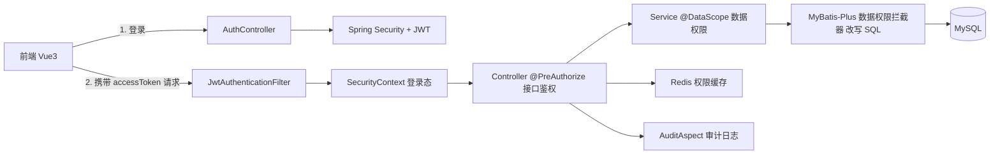

# 权限管理系统（RBAC + 数据权限 + 审计日志）

一个面向后台管理系统的权限模块：用户、角色、权限点、组织架构建模，实现菜单 / 按钮 / 接口 / 数据四层权限控制，并记录关键操作审计日志。

## 一、技术栈

| 层次 | 选型 |
| --- | --- |
| 语言 / 框架 | Java 17、Spring Boot 3.3、Spring Security 6 |
| 认证 | JWT 双令牌（access + refresh），refresh 令牌落 Redis |
| 持久层 | MyBatis-Plus 3.5（分页插件 + 数据权限插件） |
| 存储 | MySQL 8.0、Redis 7 |
| 前端 | Vue 3 + Vite + Element Plus + Vue Router |
| 构建 | Maven |

## 二、系统架构



分层职责：

| 层 | 职责 |
| --- | --- |
| `security` | JWT 生成解析、登录态还原、401/403 统一响应 |
| `service` | 业务逻辑 + 权限缓存失效 + 数据范围计算 |
| `datapermission` | 数据权限规则上下文与 SQL 改写 |
| `aspect` | `@DataScope` 设置数据范围、`@Audit` 记录审计日志 |
| `controller` | 接口定义与 `@PreAuthorize` 权限点校验 |

## 三、权限模型

四层权限自上而下收紧：

| 层次 | 实现位置 | 示例 |
| --- | --- | --- |
| 菜单权限 | 后端 `/auth/me` 返回菜单树；前端按菜单渲染导航 | 是否看到"用户管理" |
| 按钮权限 | 前端 `v-permission` 指令 | 是否显示"删除用户"按钮 |
| 接口权限 | 后端 `@PreAuthorize("hasAuthority('system:user:delete')")` | 能否调用 `DELETE /system/user/{id}` |
| 数据权限 | `@DataScope` + MyBatis-Plus 拦截器改写 SQL | 只能看本部门 / 仅本人数据 |

权限编码规范为 `模块:资源:操作`，菜单、按钮、接口共用同一套编码，前端拿到 `permissions` 数组即可判断，后端用同一个字符串鉴权。

数据库表（`sql/schema.sql`）：

| 表 | 作用 |
| --- | --- |
| `sys_user` | 用户 |
| `sys_role` | 角色（含 `data_scope` 数据范围） |
| `sys_permission` | 权限点（菜单 / 按钮 / 接口） |
| `sys_user_role` | 用户-角色关系 |
| `sys_role_permission` | 角色-权限关系 |
| `sys_org` | 组织架构（`ancestors` 存祖级路径） |
| `sys_audit_log` | 操作审计日志 |

> 表名统一加 `sys_` 前缀：`role`、`rank` 等在 MySQL 8 中是保留字，直接叫 `role` 会带来转义麻烦。

## 四、核心设计

**认证**：`access` 令牌 60 分钟、`refresh` 令牌 7 天；refresh 令牌存入 Redis，登出即删除，刷新时旋转（旧的立刻失效），避免刷新令牌被反复使用。密码使用 BCrypt 存储。

**权限缓存**：权限判定是每个接口都要走的热路径。用户权限点集合与角色列表缓存在 Redis（默认 1800 秒）：

- 给用户改角色 → 只清该用户缓存；
- 改角色的权限点 → 清理全部权限缓存（影响面大）。

**数据权限**：`@DataScope` 注解 + AOP 把当前用户的数据范围写入 `ThreadLocal`，MyBatis-Plus 的 `DataPermissionInterceptor` 在改写 SQL 时读取，只对 `sys_user` 表追加 `org_id in (...)` 或 `id = 当前用户`。

要点：

1. 用 JSQLParser 表达式构造条件（`LongValue` / `InExpression`），不拼 SQL 字符串，天然规避注入；
2. 多角色取"最宽"范围（全部 > 本部门及以下 > 本部门 > 仅本人），与权限取并集的习惯一致；
3. 拦截器顺序是数据权限在前、分页在后，保证分页 `total` 也是过滤后的数量，不会通过总数泄露越权数据规模；
4. 方法执行完毕 `finally` 清理 `ThreadLocal`，避免线程复用串权限；
5. 内部任务可用 `@DataScope(ignore = true)` 跳过过滤。

**审计日志**：`@Audit(module, value)` 标注在写操作接口上，切面记录操作人、模块、操作、请求参数、IP、成功/失败、耗时与异常信息。审计写入失败只打日志、不影响主流程。

## 五、快速开始

### 1. 环境

- JDK 17、MySQL 8.0（本机已有）、Redis（本项目默认端口 6379）
- 前端需要 Node.js 18+

### 2. 建库建表

```bash
mysql -u root -p < sql/schema.sql
mysql -u root -p < sql/data.sql
```

### 3. 改数据库密码

编辑 `src/main/resources/application.yml` 的 `spring.datasource.password`，或启动时用环境变量覆盖：

```bash
set DB_PASSWORD=你的密码
```

### 4. 启动 Redis

本机 Redis 目录：`D:\gongju\Redis-8.8.0-Windows-x64-msys2-with-Service`，双击 `redis-server.exe` 或注册为服务。默认监听 127.0.0.1:6379。

### 5. 启动后端

用 IDEA 直接运行 `PermissionApplication`，或命令行：

```bash
mvn spring-boot:run
```

启动日志出现 `已初始化 4 个演示账号的密码为 123456` 说明数据库连接与演示数据都正常。

### 6. 启动前端

```bash
cd web
npm install
npm run dev
```

浏览器打开 http://localhost:5173 。前端 dev server 已把 `/auth`、`/system` 代理到 `http://127.0.0.1:8080`。

### 7. 演示账号（密码均为 `123456`）

| 账号 | 角色 | 组织 | 数据范围 |
| --- | --- | --- | --- |
| admin | 超级管理员 | 总公司 | 全部数据 |
| zhangsan | 部门主管 | 研发部 | 本部门及以下 |
| lisi | 普通员工 | 后端组 | 仅本人 |
| wangwu | 普通员工 | 财务部 | 仅本人 |

## 六、接口清单

| 方法 | 路径 | 权限点 |
| --- | --- | --- |
| POST | `/auth/login` | 无需登录 |
| POST | `/auth/refresh` | 无需登录 |
| POST | `/auth/logout` | 登录即可 |
| GET | `/auth/me` | 登录即可（返回用户、角色、权限点、菜单树） |
| GET | `/system/user/page` | `system:user:list` |
| POST / PUT / DELETE | `/system/user` 等 | `system:user:add` / `edit` / `delete` |
| PUT | `/system/user/{id}/roles` | `system:user:assign` |
| GET / POST / PUT / DELETE | `/system/role` 等 | `system:role:list` / `add` / `edit` / `delete` |
| PUT | `/system/role/{id}/permissions` | `system:role:assign` |
| GET / POST / PUT / DELETE | `/system/permission` 等 | `system:permission:*` |
| GET / POST / PUT / DELETE | `/system/org` 等 | `system:org:*` |
| GET | `/system/audit/page` | `system:audit:list` |


## 七、目录结构

```text
permission-system
├── pom.xml
├── sql/                      # 建表与演示数据
├── src/main/java/com/liu/permission
│   ├── annotation/           # @DataScope、@Audit
│   ├── aspect/               # 数据权限切面、审计切面
│   ├── common/               # 统一返回、异常处理、枚举
│   ├── config/               # Security、MyBatis-Plus、启动初始化
│   ├── controller/           # 认证与系统管理接口
│   ├── datapermission/       # 数据权限上下文、规则、SQL 改写
│   ├── dto/                  # 请求参数
│   ├── entity/ mapper/       # 实体与 Mapper
│   ├── security/             # JWT、登录态、过滤器
│   └── service/              # 业务逻辑与权限缓存
└── web/                      # Vue3 + Element Plus 最小管理台
```
